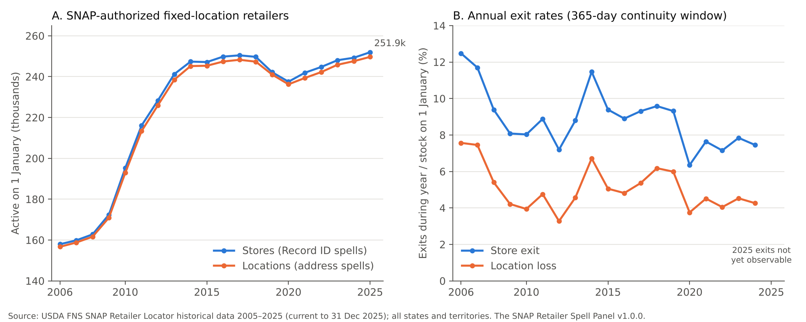

# The SNAP Retailer Spell Panel, 2005–2025

**Version 1.0.0 — October 2026.**

A cleaned, geocoded, spell-level panel of every retailer authorized to accept SNAP (food stamp) benefits in the
United States at any time from 2005 to 2025. It is built from USDA's SNAP Retailer Locator historical file.

The source lists one row per authorization. This dataset turns that list into three things:

- **Store spells:** when each store entered and left SNAP.
- **Location spells:** when each street address had, or lost, SNAP retail of any kind.
- **Geography:** every record carries a 2020 census tract and county, so the panel joins directly to Census, ACS and
  USDA Food Access Research Atlas data.



## Contents

| File | Rows | One row per |
|---|---:|---|
| `data/processed/authorizations_part1.csv.gz`, `_part2.csv.gz` | 703,441 | FNS authorization record (every record in the source; nothing dropped). Split by Record ID into two files for upload limits; stack them to use. |
| `data/processed/store_spells.csv.gz` | 669,515 | store spell (661,456 stores) |
| `data/processed/location_spells.csv.gz` | 479,150 | address spell (425,095 addresses) |
| `data/processed/national_year.csv` | | year × store group: stock on 1 January, entries, exits, rates |
| `data/processed/county_year.csv.gz` | 374,507 | county × year × store group |
| `data/processed/tract_year.csv.gz` | 1,331,364 | census tract × year (73,633 tracts) |
| `data/processed/qa_report.txt`, `stats.json` | | quality report; every number in this README |

Every column is defined in [`docs/CODEBOOK.md`](docs/CODEBOOK.md). Read [`docs/LIMITATIONS.md`](docs/LIMITATIONS.md)
before using the data.

## What was done

- **Cleaned.**
  - All 703,441 records from all 53 states and territories are kept. Problems are
    flagged, not deleted.
  - ZIP codes that had lost their leading zero (52,336 records) are restored.
  - Coordinates of (0, 0) (4,571 records) are set to missing.
  - Flags mark FNS's 1930 placeholder start dates (6,666), end dates earlier than start
    dates (45), and 54 administrative batch end dates.
- **Geocoded.**
  - 698,770 records (99.34%) were placed in a 2020 census tract
    from their FNS coordinates. Coordinates outside the record's own state were rejected.
  - The remaining records got a county from the FNS county name or ZIP code, so county coverage is 100.0%.
  - The point-based county differs from the FNS county field for 5,413 records; each such record
    is flagged.
- **Spell-constructed.**
  - Authorizations of the same store, and of the same address, are merged into spells when a gap is 365
    days or less.
  - Restricted to the 50 states and DC and to fixed-location retailers, the spells reproduce exactly those in
    *Retailer Churn and Food Access* (Adesiyan 2026, doi:10.5281/zenodo.22884651).

In 2006–2024 stores left SNAP at an average of 8.8% a year. Addresses lost
all SNAP retail at 5.0% a year. On 1 January 2025,
251,948 fixed-location stores were active.

## Rebuild it

Python 3.11 with pandas, numpy, pyarrow, geopandas (shapely, pyogrio) and matplotlib.

```
python code/01_fetch.py        # downloads or checks the two inputs and logs SHA-256 to data/raw/PROVENANCE.txt
python code/02_clean.py        # cleaned authorization records
python code/03_geocode.py      # 2020 tract and county for every record
python code/04_spells.py       # store and location spells; optional argument = continuity window in days (default 365)
python code/05_panels.py       # national, county and tract annual panels
python code/06_qa.py           # data/processed/qa_report.txt and stats.json; exits 1 on a failed check
python code/07_figure.py       # docs/figures/overview.png
python code/08_docs.py         # this README, LIMITATIONS, CITATION.cff, .zenodo.json
```

USDA and Census servers sometimes refuse scripted downloads. If `01_fetch.py` stops, save the file from the landing
page below into `data/raw/` under the name it prints. The script then checks the hash.

## Sources

| Source | Vintage | Landing page |
|---|---|---|
| USDA Food and Nutrition Service, SNAP Retailer Locator historical data 2005–2025 | current to 31 Dec 2025 (page updated 19 Feb 2026) | https://www.fns.usda.gov/snap/retailer-locator/data |
| U.S. Census Bureau, 2020 cartographic boundary file, census tracts, 1:500,000 (`cb_2020_us_tract_500k`) | 2020 tracts (file dated May 2023) | https://www.census.gov/geographies/mapping-files/time-series/geo/cartographic-boundary.2020.html |

Both are U.S. government works in the public domain. File hashes are in `data/raw/PROVENANCE.txt`. The raw inputs are
not redistributed here; `01_fetch.py` fetches them.

## License and citation

Code is under the [MIT License](LICENSE). Data and documentation are under [CC BY 4.0](LICENSE-DATA); please also
credit USDA FNS and the U.S. Census Bureau as sources.

Cite as: Adesiyan, T. F. (2026). *The SNAP Retailer Spell Panel, 2005–2025* (Version 1.0.0) [Data set]. Zenodo.

Related work: Adesiyan, T. F. (2026). *Retailer Churn and Food Access* (Version 0.1.0). Working paper. Zenodo.
https://doi.org/10.5281/zenodo.22884651

Maintainer: Taiwo Adesiyan, Middle Tennessee State University, Murfreesboro, Tennessee, USA · adesiyanfausiyat010@gmail.com · ORCID 0000-0002-2023-3624
